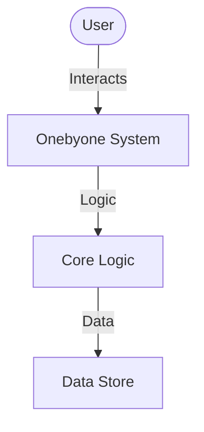

# Onebyone — Technical Research Implementation

One-By-One is a minimalist, high-performance Flask tracking server designed for orchestrating and logging request telemetry. It provides a specialized `/track` endpoint for capturing granular details (IP, User-Agent, Referer, and custom query arguments) from web interactions or tracking pixels.

## Concepts & Architecture

This project focuses on the modular implementation of onebyone, emphasizing clean separation of concerns and maintainable pattern design.

## Technical Implementation

### Core Technology Stack
| Layer | Technology | Purpose |
| :--- | :--- | :--- |
| **Language** | Python | Data processing & scripting |
| **Runtime** | Python 3.x | backend execution environment |

### Key Modules
- **`src/`**: The primary source code directory.

## Core Research Pillars

- **Modular Architecture**: Investigating the benefits of component isolation in onebyone.
- **Performance Optimization**: Researching key bottlenecks in the execution pipeline.

## Future Research & Ideas

- **Test Coverage**: Expanding the unit test suite to cover edge cases.
- **Feature Expansion**: Integrating additional modular capabilities.
